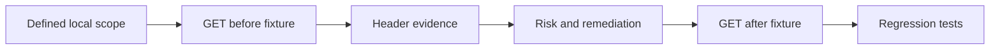

# Web security assessment lab

A reproducible HTTP security baseline review by Cristobal Samano Osuna, developed with AI assistance. Includes a local before/after fixture, assessment script and integration tests. This is a narrow assessment exercise, not a comprehensive pentest or an automated proof of exploitability.

## Run

Python 3.10+, standard library only. Terminal 1:

```shell
python lab_server.py
```

Terminal 2:

```shell
python assess.py http://127.0.0.1:8769/before
python assess.py http://127.0.0.1:8769/after
python -m unittest -v
```

Expected: three informational findings before remediation and zero findings for these specific checks afterward. Zero findings does not mean a secure application. Ctrl+C stops the server. Automated tests use an ephemeral local port and shut down their servers.

## Method and evidence



| Finding | Evidence in /before | Remediation in /after | Interpretation |
|---|---|---|---|
| Content Security Policy absent | No CSP header | default-src none, frame-ancestors none, base-uri none | Defense in depth, not evidence of XSS |
| MIME sniffing protection absent | No X-Content-Type-Options | nosniff | Useful with correct Content-Type |
| Referrer policy absent | No Referrer-Policy | no-referrer | Privacy baseline, browser defaults may already limit leakage |

The fixed CSP suits this static fixture only. Real applications need tested resource allowlists or nonces and functionality regression tests. Informational severity avoids overstating missing headers as exploitable vulnerabilities. The tool flags unsafe-inline for manual review but does not implement a complete CSP parser.

## Scope controls

One GET request to a literal loopback IP. HTTP only for this deliberately local fixture. Redirects are refused, DNS names rejected, environment proxies disabled. No authentication attempts, payload injection, directory brute forcing or external scanning. The script does not evaluate TLS, authorization, sessions, business logic, SQL injection or JavaScript execution.

## Assessment report

Scope: two local fixture routes. Objective: identify missing baseline headers and verify explicit corrections. Evidence: response headers captured in memory and returned finding identifiers; integration tests compare both routes. Outcome: three baseline gaps corrected by the fixture's /after route. Residual risks: all application classes outside the stated scope remain unassessed. No client or production data is used.

## Extension plan

Run OWASP Juice Shop locally in an isolated environment, document authorization and exact version, and assess one vulnerability category manually using OWASP WSTG. Keep screenshots and remediation notes tied to actual observations. This repository does not claim a completed Juice Shop assessment. References: https://owasp.org/www-project-web-security-testing-guide/ and https://owasp.org/www-project-secure-headers/

## Entrevue — français

Explique pourquoi un en-tête absent n'est pas automatiquement une vulnérabilité exploitable, comment vérifier le correctif, et pourquoi un résultat sans alerte ne prouve pas la sécurité d'une application. Ajoute un contrôle avec un cas positif et un cas négatif pour t'approprier le projet.
